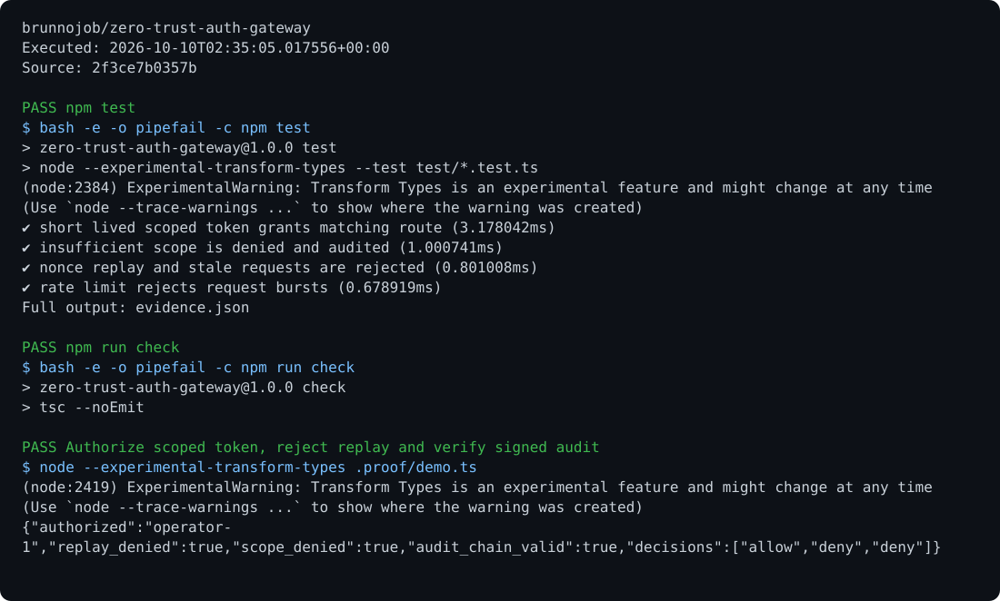

# Auth Gateway

A gateway with short-lived tokens, scopes, replay protection, limits, and auditing, plus Supabase authentication for private report access.

## Run

Requirements: Node.js 24 and TypeScript.

```sh
npm ci
npm test
npm run check
npm start
```

## Behavior

Set `GATEWAY_SECRET`, `SUPABASE_URL`, and `SUPABASE_PUBLISHABLE_KEY`. `/v1/reports` verifies the Supabase session and requires a unique `X-Request-Nonce`. Nonces and limits for this flow are stored in PostgreSQL. Local tokens are intended for the local server.

## Optional report archive

Use the [shared operations archive client](https://github.com/brunnojob/vercel-home-telemetry-api/tree/main/cloud) to queue `result.json` under project `zero-trust-auth-gateway`. The client uses `BRUNNODEV_ACCESS_TOKEN` and retains unacknowledged reports locally.

## License

Original source and documentation are MIT licensed; see [LICENSE](LICENSE). Third-party dependencies and media retain their respective terms. Maintained by [Brunno Dev](https://brunnodev.store).

## Implementation update

Replay keys encode principal and nonce boundaries unambiguously. Guard capacity and lifetime settings require positive integers, and invalid clocks cannot prune or extend replay entries. Run `npm test`.

Contribution trailer: `Co-authored-by: nyctophile <33561761+ineedfoundmyway@users.noreply.github.com>`.

## Execution proof

[](https://github.com/brunnojob/zero-trust-auth-gateway/actions/workflows/proof.yml)



[Verified run](https://github.com/brunnojob/zero-trust-auth-gateway/actions/runs/38017991076) · [Execution report](docs/proof/evidence.json)

Run `python .proof/record.py` after installing the prerequisites above. The scenarios execute repository code and verify exit codes and expected output. CI publishes `execution-proof` with the transcript, input fingerprints and source commit. The downloadable report identifies the exact tested version; the workflow badge tracks the latest run.
